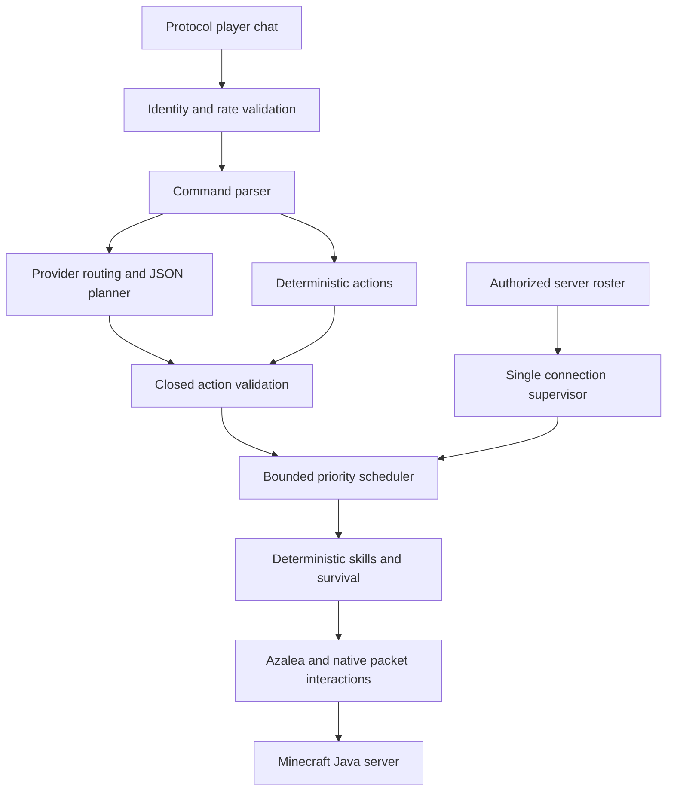

# Native Minecraft companion

This is a separate Rust executable beside the retained TypeScript implementation. Its runtime uses Azalea, Tokio and Rust HTTP clients; it never launches Node, JavaScript, TypeScript or Mineflayer. **Full migration acceptance is still open.** Read [migration gates](../docs/migration.md) before deploying to a real world.

## Supported protocol

Minecraft Java **1.21.4**, protocol **769**. Azalea is pinned to `4fb6b077464e14f816e4c4fe54ff648e8c3d0ede`; Rust is pinned to `nightly-2025-03-01`. A status ping checks protocol compatibility before a session starts. `MC_VERSION` must be empty or `1.21.4`; it cannot make this executable speak another protocol. The owner's Aternos version and authentication mode have not been supplied.

## Build and run

```sh
cargo build --release --locked
cp .env.native.example .env
# Edit .env: server, bot account, authorized players, containers and regions.
./target/release/minecraft-companion --check-config
./target/release/minecraft-companion --ping
./target/release/minecraft-companion
```

The default supervisor waits offline. Start your server manually, join as an authorized real player, then type `join` in the bot's local terminal. `leave` ends its session, `stop` cancels gameplay and planning, and `quit` exits. `--connect` is an explicit one-time manual activation. It does not enable reconnect loops. Linux SIGTERM and Ctrl+C cancel tasks and close the connection.

For Windows without MSVC Build Tools, install 64-bit MSYS2 UCRT64 GCC and use `./scripts/build-windows.ps1 -Release`. The workspace name contains an apostrophe, which GNU linker response files mishandle; that script puts build output in `D:\minecraft-rust-build`. It does not move or delete source. MSVC and other output locations can be used with a suitable compiler installation. Linux uses the pinned toolchain directly. ARM64 Linux should build natively using the same commands, but has not been tested on hardware.

Microsoft authentication shows a device-login prompt locally and stores tokens in `MC_PROFILES_PATH`. Use a Minecraft-owning account matching `MC_USERNAME`. Protect that directory: owner-only permissions, private Docker volume, no repository commits. Linux directories are mode 0700 and the cache is 0600. Windows ACLs should restrict it to the account running the bot. Offline authentication must be selected explicitly and requires an offline-mode server; username identity cannot authenticate ownership in that mode.

## Commands and AI

Legacy JSON memory can be converted offline with `--import-memory LEGACY_FILE --memory-output NEW_FILE --memory-dimension minecraft:overworld`. The destination must be new; the source is preserved. See [memory import](../docs/memory-import.md) for dimension selection and limits. Remembered trust never changes the command allowlist.



`!come`, `!goto x y z`, `!follow [player] [distance]`, `!guard player`, `!stop`, `!stay`, `!pickup [item] [count]`, `!mine block [count]`, `!deposit [item]`, `!withdraw [item] [count]`, `!equip item`, `!drop item [count]`, `!eat [item]`, `!inventory`, `!status`, `!remember name`, `!home`, `!help`.

`!follow` defaults to its requester. Only authorized protocol player identities may command the bot. System/disguised messages that merely contain a username are ignored. UUID pins are optional for trusted online-mode identity. The bot uses server tab-list identities for presence and separate loaded entity positions for movement.

AI is optional. Groq, Gemini, OpenAI and OpenRouter use their real HTTPS APIs through one Rust provider trait. Existing singular keys/models and optional comma-separated `*_API_KEYS` are supported. Requests have a total deadline, per-provider fallback budget, concurrency limit, rate-limit cooldown and circuit state. Authentication rejection disables that provider until restart. Model availability, free quotas and charges depend on the provider and your account; no paid account, trial, subscription or spending limit is changed by this application.

An AI plan is strictly JSON with at most eight validated actions. Unknown actions, fields, wrong types and unsafe values are refused. AI cannot invoke shells, server administration, local file reads or code. The context contains bounded gameplay state, known locations and recent authorized conversation, never environment variables or credential files. Raw provider errors and model prose are not sent to chat.

## Safety and inventory

One scheduler worker owns all movement, mining, building, combat and inventory operations. A new instruction supersedes a running instruction. Emergency/defensive reflexes can interrupt safe resumable movement tasks. Explicit stop remains latched against autonomous behavior until a fresh instruction. Mining and transfers are not replayed after interruption.

Container transfers require coordinates in `AUTHORIZED_CONTAINERS`, e.g. `minecraft:overworld@10,64,20`. `PROTECTED_REGIONS` protects coordinate ranges. The bot refuses structure blocks, dangerous blocks, mining under itself, nearby player feet and resources adjacent to containers/workstations/torches. These heuristics cannot identify every player-placed natural block: configure regions around builds. Placement requires loaded empty space and a reachable support face. The bot remembers its own placed blocks for that process.

Inventory prediction is disabled for direct container clicks so the server sends actual slot/cursor changes. Transfer success requires matching decreases and increases in server-observed counts. A cancelled transfer closes the container; the server owns returning the cursor stack. Do not claim atomic rollback: a partial transfer may already have happened and is reported as failure/cancellation.

Stack limits and durability now use all 1,385 vanilla item defaults from Mojang's 1.21.4 reports, with per-stack overrides/removals. See [item provenance](../docs/item-properties.md). Container opening waits for server contents. Cancelled late replies are closed; another open request is refused while a previous reply is outstanding. If the server never replies, rejoin manually before retrying.

Neutral mobs become defensive targets only after confirmed attacks on the bot or an authorized teammate. Players remain excluded. Wardens/bosses, angry endermen and active creakings trigger conservative retreat. Movement guards may stop a path when it approaches those threats; live evasion and safe-route coverage still need testing.

## Test and deployment

```sh
cargo fmt --all -- --check
cargo clippy --workspace --all-targets --locked -- -D warnings
cargo test --workspace --locked
cargo build --release --locked
```

The local Java fixture is intentionally ignored in normal CI. You requested that it be left ready without accepting the Minecraft EULA. See the [verification record](../docs/validation.md) and [live tests](../docs/testing.md). See [deployment](../docs/deployment.md) for Docker, Linux services, ARM64 and researched free-host restrictions, and [performance](../docs/performance.md) for measured results and unmeasured workloads.
